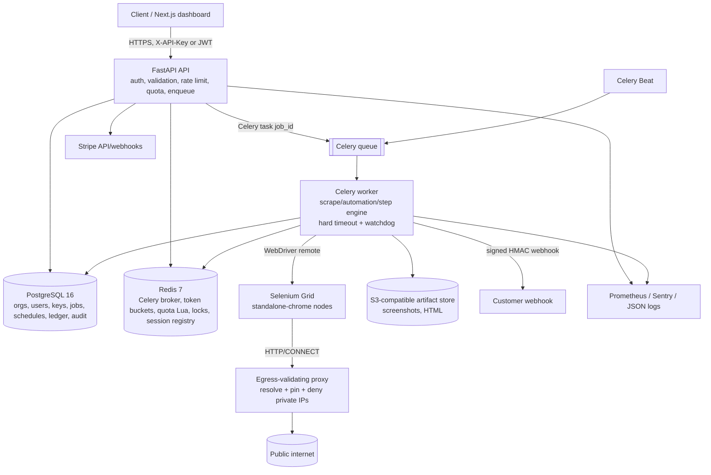

# ScrapeFlow — Target Architecture and Execution Plan

Baseline: `docs/analysis/01-system-map.md`, `02-gap-matrix.md`, `03-risk-review.md`. This plan converts the 512-line MVP into the spec'd multi-tenant platform. Phase 0 is complete and no source code has been modified.

## 1. Target architecture



Key invariants:
- The API never imports a WebDriver. Only `apps/worker` can create browser sessions.
- Postgres is the source of truth for jobs/state; Redis is ephemeral coordination; object storage holds large artifacts.
- Every browser connection goes through the egress proxy. Private/loopback/link-local/metadata/reserved destinations are denied at **connect** time, not just request time.
- Every job has a DB row, a hard deadline, a cancel flag, a session-registry entry, and `finally` cleanup; a reaper removes orphans.
- All external callbacks are signed, timestamped, redirect-disabled, retried, and recorded.

## 2. Repository target

```
scrapeflow/
  pyproject.toml            # ruff, mypy strict, pytest, coverage, deps (uv lock)
  apps/
    api/
      main.py               # app factory, middleware, exception handlers, lifespan
      deps.py               # auth, db, rate limit, quota
      errors.py             # typed error codes + envelope
      routers/              # health, auth, keys, scrape, automate, jobs, exports,
                            # schedules, billing, webhooks, audit
      schemas/              # Pydantic request/response models
      services/             # jobs, auth, quota, billing, schedules, webhooks, audit
    worker/
      celery_app.py
      tasks/                # scrape, automate, reaper, schedules, webhooks, retention, reconcile
      browser/              # driver factory, runner, step engine, extraction, pagination, proxy
      providers/            # proxy provider interface + static/rotating
    web/                    # Next.js App Router + TS + Tailwind
  packages/
    core/                   # settings, db models/session, security, errors, plans, crypto, ssrf
  migrations/               # Alembic, forward-only
  tests/{unit,integration,e2e}/
  deploy/                   # compose.prod.yml, Caddyfile, grafana, egress policy docs
  docs/                     # API guide, clients, runbook, decisions, security
  .github/workflows/
```

The existing `app/` modules are kept as reference until the replacement passes tests, then removed in the same phase (git history retains them).

## 3. Work breakdown

Each item lists goal, files, tests, acceptance, dependencies, rollback. Effort estimates assume one senior engineer.

### Phase 1 — Foundation (S)
**Goal:** runnable skeleton with config, logging, errors, health/ready, compose, CI, tooling.
- Files: `pyproject.toml`, `apps/api/main.py`, `apps/api/errors.py`, `apps/api/routers/health.py`, `packages/core/settings.py`, `packages/core/logging.py`, `docker-compose.yml`, `deploy/compose.prod.yml` (skeleton), `Caddyfile`, `.github/workflows/ci.yml`, `.pre-commit-config.yaml`, `.env.example`, `Makefile`.
- Tests: settings fail-fast; error envelope; request-ID propagation; `/health` 200, `/ready` 503 without deps and 200 with fakes.
- Acceptance: `ruff check`, `ruff format --check`, `mypy`, `pytest` green; app starts with valid env and refuses to start with missing secrets; compose config validates (`docker compose config`).
- Depends: none. **Rollback:** revert commit; old `app/` untouched.
- Notes: Pydantic settings with required `DATABASE_URL`, `REDIS_URL`, `API_KEY_PEPPER`, `JWT_SECRET`, `WEBHOOK_SECRET_KEY`; dev defaults only in `.env.example`; 12-factor.

### Phase 2 — Database, tenancy, auth, keys, rate limits (L)
**Goal:** orgs/users/roles, hashed scoped keys, JWT login, per-org/IP limits, seeded demo.
- Files: `packages/core/db.py`, `models.py`, `security/keys.py`, `security/jwt.py`, `apps/api/routers/{auth,keys}.py`, `services/auth.py`, `middleware/rate_limit.py`, `migrations/versions/*`, `scripts/seed.py`.
- Data: organizations, users, memberships(role), api_keys(prefix, hash, scopes, last_used_at, revoked_at), refresh_tokens, audit_logs, usage_ledger.
- Tests: key format/hash/pepper/constant-time; collision/prefix lookup; scope enforcement; revocation; last-used update; JWT expiry/refresh; role matrix; rate-limit Lua (unit + real Redis); migration up/down-to-base (down only in test DB); tenant isolation (org A cannot read org B).
- Acceptance: create org/user/key → authenticate → 401 after revoke; 429 with `Retry-After` and `X-RateLimit-*`; demo org/key printed by seed and documented; Alembic upgrade on empty DB.
- Depends: P1. **Rollback:** revert code + `alembic downgrade -1` on non-prod; prod forward-fix only (migrations forward-only).
- Security: Argon2id passwords, JWT HS256 with rotation-ready `kid`, key pepper from env, no key material in logs.

### Phase 3 — Durable jobs, worker, Grid, scrape, SSRF, artifacts (L)
**Status (2026-11-01):** Implemented. Live API→Celery→Postgres HTTP scrape, artifacts, download, and events verified; 130 tests pass. Grid/browser and MinIO/S3 paths remain UNVERIFIED (Docker denied, no Chrome).
**Goal:** production scrape path with durable jobs, isolated browser execution, hard timeout, reaper, typed errors, artifacts.
- Files: `apps/worker/celery_app.py`, `tasks/jobs.py`, `tasks/reaper.py`, `browser/driver.py`, `browser/scrape.py`, `browser/extract.py`, `browser/pagination.py`, `packages/core/ssrf.py`, `apps/worker/egress_proxy.py`, `apps/api/routers/{scrape,jobs}.py`, `services/jobs.py`, `packages/core/artifacts.py`, compose Grid/proxy/MinIO.
- Data: jobs(status, kind, payload JSONB, result JSONB, error_code, error_details, org_id, schedule_id, credits, timestamps, attempts, cancel_requested_at, request_id, idempotency_key), job_events, artifacts.
- Scrape schema: URL ≤ 2048; selectors CSS/XPath (exactly one), `attr`, `all`, `limit`; `wait_for`; `render_js`; screenshot; include_html; extract options; pagination; `proxy_country`; webhook.
- SSRF: `validate_url()` rejects userinfo, non-http(s), bad ports, >2048 chars, resolves all A/AAAA, denies non-global; egress proxy repeats resolution and pins the connected IP; redirects checked per hop (HTTP path) and final URL checked (browser path); webhook URLs use the same validator and redirects disabled.
- Worker: Celery `acks_late`, `prefetch_multiplier=1`, `reject_on_worker_lost`, soft/hard limits; watchdog closes session at deadline; session registry keyed by job with TTL; reaper kills stale Grid sessions; `finally` quits and clears.
- Tests: SSRF unit matrix (IPv4/IPv6, octal/decimal/hex, mapped, userinfo, ports, redirects, rebinding simulated), egress proxy allow/deny, scrape schema, extraction, pagination, job lifecycle integration (PG+Redis), local static site Selenium (render + screenshot), timeout/cancel, reaper, idempotency, tenant isolation, artifact upload/download, `render_js=false` HTTP path.
- Acceptance: local page returns title/text/links/selector/screenshot; internal URLs and redirect-to-internal rejected; kill worker mid-job → reaper removes session; job never exceeds deadline.
- Depends: P1, P2. **Rollback:** revert commit; dispatch guarded by `QUEUE_ENABLED`; Grid/proxy additive.
- Env note: Docker is unavailable to this user. Grid e2e will use a locally downloaded Chrome + Selenium (and optionally a local Grid jar) for verification; compose/Grid network checks are marked UNVERIFIED unless access is granted.

### Phase 4 — Automation step engine (L)
**Status (2026-11-02):** Implemented. Typed step union, retries/optional/deadline handling, AES-GCM-sealed Redis secrets, failure screenshots, and partial results; 167 tests pass (1 Grid-specific skip plus a real local Chrome run) and 78.18% branch coverage. Real Chrome for Testing exercised every action, secret interpolation, a real failure screenshot, and a local static site; Selenium Grid/egress-proxy compose remains UNVERIFIED.
**Goal:** fully typed, retryable, secret-safe automation with failure artifacts.
- Files: `apps/api/schemas/automation.py`, `apps/worker/browser/steps.py`, `browser/runner.py`, `services/secrets.py`, `routers/automate.py`.
- Models: discriminated union `goto|click|type|press|select|hover|wait_for|sleep|scroll|extract|get_text|screenshot|execute_if_present|loop_pages`; base `optional`, `timeout_s`, `retries`; nested steps capped (depth 3, total steps ≤ plan).
- Secrets: request `secrets` map validated (names/length); values AES-GCM-encrypted into Redis with job TTL; worker decrypts, uses, deletes; never in DB/logs/response; interpolation only in `type.text`, `select.value`, maybe `press.key`; logs/result redacted; fields cleared before failure screenshot where tracked.
- Tests: union rejects unknown action/missing/extra fields; every action; retries on transient vs permanent; optional; execute_if_present; loop_pages; timeout; secret redaction (logs/response/DB), secret deletion; failure screenshot exists.
- Acceptance: local static form type/click/wait/extract completes; failing selector returns log + failure screenshot; no secret appears in DB rows, API JSON, or captured logs.
- Depends: P3. **Rollback:** revert commit; `automation_v2` flag.

### Phase 5 — Plans, credits, quotas, Stripe (L)
**Status (2026-11-02):** Implemented. Plan catalog, atomic credit reservation/settlement, Redis concurrency leases, `X-Quota-*` headers, 402/429 plan errors, reconciliation, artifact retention purge, and Stripe checkout/portal/webhook lifecycle with event idempotency; 187 tests pass (1 Grid-specific skip) with 77.90% coverage. Migration `f858743db2d5` upgrade→check→downgrade→re-upgrade verified on a disposable DB. Live Stripe checkout is UNVERIFIED (no test keys); tests exercise the SDK surface with fakes and locally signed payloads.
**Goal:** monetizable metering with atomic limits and Stripe lifecycle.
- Files: `packages/core/plans.py`, `services/quota.py`, `services/billing.py`, `routers/{billing,webhooks}.py`, `tasks/{reconcile,retention}.py`, migrations.
- Plans (config): Free 100 credits/1 concurrent/10 steps/5 pages/1-day artifacts; Starter 5k/3/50/25/7d; Pro 50k/10/100/100/30d; Business 250k/25/200/500/90d. Weights: base 1, browser 1, screenshot 1, proxy 2, per extra page 1, per 10 steps 1.
- Quota: Lua reserve at creation; release on pre-execution failure; commit on success; period key `org:{id}:usage:{YYYY-MM}`; concurrency semaphore key with TTL; reconciliation sums `usage_ledger` into PG and repairs Redis.
- API: 402 `QUOTA_EXCEEDED`, 429 `RATE_LIMITED`/`CONCURRENCY_LIMIT`, headers `X-Quota-Limit`, `X-Quota-Remaining`, `X-Quota-Reset`, `Retry-After`.
- Stripe: checkout session, customer portal, webhook with `Stripe-Signature` verification, `stripe_events(event_id unique)` idempotency, subscription→plan mapping, usage records; billing disabled by flag in dev.
- Tests: credit math, Lua atomicity under concurrency, exhaustion/refund/reconcile, 402/429 headers, Stripe signature valid/invalid/replay/duplicate, plan change, retention purge.
- Acceptance: exhaustion returns 402 with headers; duplicate Stripe event processed once; seeded demo org has plan.
- Depends: P2, P3. **Rollback:** `BILLING_ENABLED=false` (quotas still local); forward-fix migrations.
- Unverified if no Stripe test keys: live checkout. Unit tests use test secrets; exact commands documented.

### Phase 6 — Schedules, change detection, signed webhooks, exports (L)
**Status (2026-11-02):** Implemented. Cron/IANA-timezone schedules with schema-validated templates, at-most-once occurrence dispatch via unique `schedule_runs.run_key`, watched-field snapshots and `appeared`/`disappeared`/`changed` diffs, opt-out notification gating, HTTPS-only webhook registry, AES-GCM-sealed org signing secret returned once, durable deduped outbox with HMAC signing, jittered retries and DLQ, delivery log, and streaming job/schedule CSV+JSON exports with formula-injection escaping. 265 tests pass (2 infrastructure skips) with 82.32% branch coverage. Migration `f62471a75878` upgrade→check→downgrade→re-upgrade verified on a disposable DB.
**Goal:** recurring monitoring with reliable notifications and streaming exports.
- Files: `packages/core/{schedules,webhooks,exporting}.py`, `models` additions, `routers/{schedules,webhooks,exports}.py`, `services/{schedules,webhooks}.py`, `tasks/{schedules,webhooks}.py`, migration `f62471a75878`.
- Schedules: cron + timezone validation (`croniter`), job template validated by same scrape/automate schemas, watched fields (dot/bracket paths), history, diffs (`price changed`, `appeared`, `disappeared`), enable/disable.
- Webhooks: per-org secret (returned once, AES-256-GCM encrypted at rest because HMAC needs plaintext), HTTPS-only endpoint registry, deduped outbox table, HMAC `sha256=...` over `timestamp.body`, event/delivery headers, 5-min replay window, redirects disabled, capped response reads, retries with jitter, DLQ, delivery log.
- Exports: `GET /v1/jobs/{id}/export?format=csv|json`, `GET /v1/schedules/{id}/export`; `StreamingResponse`; CSV formula-injection escaping; content-disposition.
- Tests: cron next-run, timezone, schedule dispatch lock, diff cases, signed payload/timestamp/replay, retry/DLQ, tenant scoping, streaming large export, CSV injection.
- Acceptance: schedule runs via beat; change fires signed webhook; duplicate delivery idempotent; export streams. Verified through PostgreSQL+Redis integration tests and `respx` HTTP receivers. Scheduler beat execution and customer-facing webhook delivery are exercised by unit/integration tests, not a live compose deployment.
- Depends: P3, P4. **Rollback:** disable beat schedule + revert.
- Email: optional SMTP; without SMTP, event recorded and `email_skipped=true` (decision D-007). Email delivery remains UNVERIFIED / deferred; webhooks are the implemented notification path.

### Phase 7 — Proxy providers (M)
**Status (2026-11-06):** Implemented. Static-list and authenticated rotating-gateway providers, per-job assignment with Redis round-robin, TCP health probes with cached positive results and failure cooldown, `proxy_country` validation at acceptance, bounded retry on a different endpoint after a tagged proxy failure, and credential redaction. Results record only `{id, provider, country}`. 227 unit tests and 68 integration tests pass (1 Chrome/Grid skip). A real commercial proxy provider and a live Grid/compose deployment remain **UNVERIFIED**; the gateway and retry paths are exercised with local fake upstreams.
**Goal:** pluggable, health-checked proxy assignment without evasion features.
- Files: `packages/core/proxies.py`, `apps/worker/proxies.py`, `apps/worker/providers/{base,static,gateway}.py`, `apps/api/services/proxies.py`, `apps/worker/egress_proxy.py`, `apps/worker/{scrape,automate}.py`.
- Providers: `PROXY_STATIC_LIST` parses `[COUNTRY|]http(s)://[user:pass@]host:port`; `PROXY_GATEWAY_URL` supports one `{country}` placeholder with `PROXY_GATEWAY_COUNTRIES` and `PROXY_GATEWAY_DEFAULT_COUNTRY`. Exactly one provider is required when enabled.
- Behavior: per-job acquire; `proxy_country` supported flag else 422; retry job network failure with a different proxy (max 2, `PROXY_MAX_RETRIES`); TCP health probes; Redis state (`sf:proxy:rr:*`, `sf:proxy:healthy:*`, `sf:proxy:down:*`); never CAPTCHA/stealth/fingerprint.
- Chaining: the worker attaches the leased upstream to its validating egress proxy, which still resolves and checks the destination before using `CONNECT` or absolute-form HTTP with `Proxy-Authorization`; the upstream performs the final-hop connection. Upstream failures are tagged `X-ScrapeFlow-Proxy-Upstream: 1`.
- Per-job + Grid: the worker-local proxy binds `EGRESS_JOB_PROXY_BIND_HOST` and advertises `EGRESS_JOB_PROXY_ADVERTISE_HOST`; compose uses `0.0.0.0`/`worker`. A loopback advertise host with remote Grid fails 503 rather than bypassing validation.
- Tests: provider selection, country unsupported, retry-on-failure, health failover, credential redaction, no proxy in logs, upstream CONNECT/HTTP forwarding, automation retry safety, and an integration retry against a dead then live upstream.
- Acceptance: forced proxy failure retries on a second proxy; results record proxy id (not credentials). Verified through unit tests plus PostgreSQL/Redis integration tests with a local fake upstream; a real gateway and Docker/Grid run are UNVERIFIED.
- Depends: P3, P4. **Rollback:** `PROXY_ENABLED=false` static env fallback.

### Phase 8 — Dashboard (L)
**Goal:** usable Next.js dashboard for all customer flows.
- Files: `apps/web/` pages: login/signup (+ToS), keys, scrape, automate builder, jobs list/detail, schedules, usage/billing; `lib/api.ts`; Tailwind components; middleware for JWT.
- Tests: `npm run lint`, `tsc`, unit for formatters; Playwright E2E (login, create key, scrape local page, view job, build 3-step automation, schedule, export).
- Acceptance: dashboard builds and drives the API; no heavy UI framework; accessible labels; no secrets in client storage beyond tokens.
- Depends: P2, P3, P4, P5, P6. **Rollback:** static `apps/web` deploy rollback; API versioned.

### Phase 9 — Observability, load, security pass, docs (M)
**Goal:** operable, proven, documented.
- Files: `packages/core/observability.py`, `apps/api/middleware/request_id.py`, metrics, `deploy/grafana/`, `tests/load/locustfile.py`, `docs/runbook.md`, `docs/FINAL_REPORT.md`, client examples, `docs/decisions.md`, updated gap matrix.
- Metrics: queue depth, job duration histogram, failures by code, active sessions, webhook deliveries, quota rejections, rate-limit hits, DB/Redis latency.
- Tests: metrics endpoint, log fields, readiness failure, load script smoke (not full load here).
- Acceptance: `/metrics` exposes required series; JSON logs contain request/job IDs; Sentry init; runbook covers deploy/rollback/backup/restore/scaling/incident; security checklist re-reviewed.
- Depends: all. **Rollback:** observability additive; docs reversible.

## 4. Critical path and sellable v1

**Critical path:** P1 → P2 → P3 → P4 → P6 → P8 → P9. P5 and P7 can run in parallel after P3/P4.

**Smallest sellable v1 (cut line):** P1–P4 plus the quota/auth subset of P2/P5, signed job webhooks from P6, minimal dashboard (keys, scrape, automate, jobs), runbook/observability. Defer to v1.1: proxy rotation (P7), schedules/email and exports (P6 remainder), full Stripe metered overage (P5 remainder). This still satisfies the core "scrape/automate safely and billably" promise but not every spec line — the plan executes all phases regardless.

## 5. Verification strategy (honest about this host)

| Layer | How | This host |
|---|---|---|
| Unit | pytest, no services | Runnable (venv). |
| Integration | Postgres 16 + Redis 7 via testcontainers | Docker denied. Fallback: user-space PostgreSQL 18 cluster + extracted Redis 8 binary; results labeled. CI uses pinned 16/7. |
| Browser | Selenium Grid + local static site | Docker denied; fallback Chrome for Testing (156) + chromedriver locally; Grid compose UNVERIFIED here. |
| Dashboard | Next.js build + Playwright | Node 24 available; browser download needed. |
| Stripe | signed test events, no live keys | Live checkout UNVERIFIED. |
| Compose/TLS | `docker compose up` | **Blocked** until Docker socket access is granted. Exact command provided. |
| Load | Locust smoke | Partial; real numbers only if stack runs. |

## 6. Decisions to record in `docs/decisions.md` (defaults chosen)

| ID | Decision | Alternatives | Reason |
|---|---|---|---|
| D-001 | Celery 5 + Redis broker, DB as status source | Arq, RQ | Beat, retries, ops familiarity; no result backend dependency. |
| D-002 | MinIO (S3 API) for artifacts in dev/prod | Local disk, PG bytea | Spec requires object storage; portable. |
| D-003 | Connection-time egress proxy in front of Grid | App checks only, DNS pinning only | Page JS bypasses app checks; proxy sees every connection. |
| D-004 | `render_js=true` → Grid; `false` → SSRF-safe httpx | Always browser | Matches the flag; cheaper static scraping. |
| D-005 | New orgs `respect_robots=true` | Default off | Legal safety; audited opt-out. |
| D-006 | Quota reserve at accept, refund on pre-navigation failure | Charge on completion | Prevents free concurrency abuse; deterministic headers. |
| D-007 | Email optional via SMTP; webhook always | Require SMTP | No provider specified; avoids fake email implementation. |
| D-008 | `proxy_country` unsupported → 422 | Ignore | Never silently ignore a paid feature. |
| D-009 | Key format `sf_live_<prefix>_<secret>`, SHA-256+pepper | bcrypt keys | Fast lookup by prefix + constant-time compare. |
| D-010 | Artifacts per plan retention, nightly purge | Forever | Spec + privacy. |
| D-011 | Restructure to `apps/` per spec, keep old `app/` until parity | Keep flat app | Spec layout + testability. |
| D-012 | Error codes as a `StrEnum` mapped to HTTP | Free strings | Stable client contract. |
| D-013 | Local verification services via user-space PG/Redis/Chrome when Docker denied | Skip tests | Maximizes real evidence; CI remains authoritative. |

## 7. Real blockers / questions

1. **Docker socket access is denied** to `kali-12` (not in `docker` group; sudo requires a password). This blocks compose/Grid/testcontainers/TLS acceptance. Recommended: grant access with `sudo usermod -aG docker $USER` (re-login) or run the final verification commands yourself. Not an architecture blocker; I will proceed with fallbacks and mark affected checks UNVERIFIED.
2. **Stripe account/test keys are absent.** Recommended default: implement full integration and verify signatures/idempotency locally; live checkout is UNVERIFIED. No design change needed.
3. **SMTP provider is unspecified.** Recommended default D-007.
4. **Local PostgreSQL is 18.6, not 16; Redis absent (downloadable 8.0.5).** Recommended: compose/CI pin 16/7; local integration uses 18/8 with a documented difference.

No irreversible ambiguity requires stopping; defaults above will be logged.

## 8. Quality gates per phase

- `ruff check` + `ruff format --check`; `mypy` strict on `apps/` + `packages/`.
- `pytest` unit + integration (skips only for unavailable infra, with reason); coverage threshold 80% on new core modules.
- Real end-to-end demo output for the phase feature.
- No secrets/TODOs/dead code; `pip-audit` + `npm audit` clean or documented exceptions.
- Docs + `docs/decisions.md` updated; security checklist for touched area.
- Commit per phase (repo initialized in P1); tag each phase.

## 9. Definition of done (spec acceptance)

All REQ rows move to Done (or explicitly UNVERIFIED with command) including: compose full stack + seeded demo key; local scrape/automation acceptance; SSRF rejections incl. redirect; quota/Stripe idempotency; kill-worker reaper; CI green; runbook; final report. The gap matrix in `docs/analysis/02-gap-matrix.md` is updated to final status.
